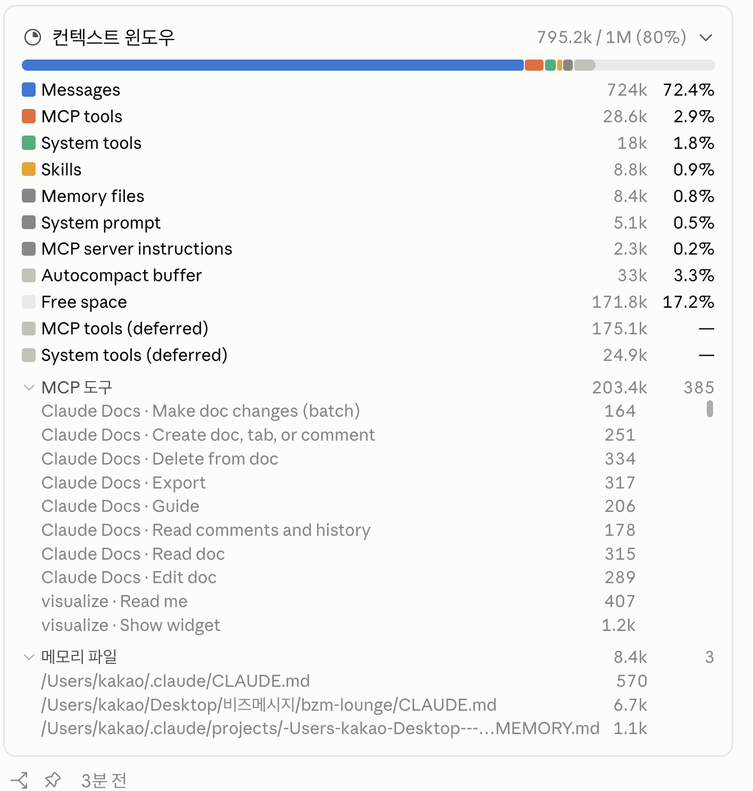

### 2026-10-21

## AI를 잘쓴다는것?
- 작업에서 병목을 파악하고 -> 해당 병목을 AI를 통해 압도적으로 시간을 단축시키며 -> AI가 옳은 결과물을 냈는지 구별할 수 있어야 함

### 1. 컨텍스트
- 모델은 컨텍스트 윈도우 안에 있는 것만으로 추론: AI가 볼 수 없는 정보들에 대해서는 알 수 없음

- **필요한 역량**
  1. 모델의 시야를 머릿속에 그릴 수 있을 것
     - 시스템 프롬프트
     - 대화의 이력
     - 열어본 파일
     - 도구 실행 결과
  2. 상태를 세션에서 외부화 할 것
     - 반복되는 규칙과 결정파일 (프로젝트 지침파일/설계 문서/결정 기록) 빼서 매 세션 자동으로 읽히게
  3. 컨텍스트가 오염된 것을 알아차릴 것
     - 잘못된 하나의 가정을 한다면 그 이후에 그 기반으로 작업하기 때문에 뇌절
     - `/rewind` 를 써볼까? 
  4. 나에게 맞는 개인화된 RAG을 만들어간다고 생각하자

- **클로드가 자동으로 읽는 파일**
  1. `CLAUDE.md`(`AGENTS.md`를 끄면 이걸 대신 읽음)
     - 아래 4가지 모두 이어붙여서 쭉 읽음. 컨텍스트에 넣는다.
        - macOS 조직 관리 정책 (`/Library/Application/Support/ClaudeCode/CLAUDE.md`)
        - 사용자 지시/모든 프로젝트에 적용 (`~/.claude/CLAUDE.md`)
        - 프로젝트 지시 (`./CLAUDE.md` or `./.claude/CLAUDE.md`)
        - 로컬 지시 (`./CLAUDE.local.md`)
  2. `.claude/rules/*.md`
     - CLAUDE.md를 주제별로 쪼갠 파일
     - YAML의 path 필드로 특정 파일에만 적용되게 범위 지정 가능
     - Claude가 매칭되는 파일을 작업할 때만 컨텍스트에 넣어줌
  3. `@path` import
     - CLAUDE.md 안에서 `@path/to/import` 문법으로 다른 파일 끌어올 수 있고, 실행시점에 로드됨
  4. auto memory
     - 프로젝트마다 `~/.claude/project/<project>/memory`에 디렉토리가 생기고, `MEMORY.md` 인덱스의 첫 200줄 또는 25KB 로드
  - 
  - 파일당 200줄 미만을 목표로!

- **명령어 tips**
  - `/init`: 코드베이스 분석, 빌드 명령, 테스트 지시, 프로젝트 규약으로 시작 CLAUDE.md, 있으면 개선안 제시
  - `/doctor`: 점검된 커밋된 CLAUDE.md에서 디렉토리 구조, 의존성 목록, 아키텍처 개요처럼 코드베이스에서 유도할 내용은 자르고, 함정/근거/도구 기본값과 다른 규약 남기기
    - `/init`이 만든것중 '코드보면 아는것' 지우고, '코드봐도 모르는것' 남기기
  - 새로운 세션에서 쓰세요

### 2. 뭘 직접 할 수 있는가? (도구 실행/파일 접근)
- **모델이 조언하는 것 vs 직접 실행하는 것**
  - 속도가 아니라 누가 피드백 루프를 닫는지
  - ex. 테스트를 모델이 직접 돌릴 수 있으면, 틀린 걸 모델이 스스로 발견하고 고침
    - 여기서 내가 루프 안에 있으면 내가 병목이 되겠지

- **필요한 역량**
  1. 모델에게 검증 수단을 쥐여주는 것
     - 맞는지 확인하는 방법을 모델에게 알려주기 (테스트, 타입 체크, 린터, 실행 스크립트)
  2. 환경을 재현 가능하게
     - `make test`만 쳐도 뚝딱 돌릴 수 있는 레포 >> DB 띄우고 볼트에 옘병
  3. 도구의 출력을 모델이 읽을 수 있도록
     - 실패시 명확하게 알려주고, 출력 길지 않을 것
  4. 뭘 주지 않을지 정하기
     - DB 쓰기 권한, 시크릿, 외부 결제 API 등 닿지 말아야 할 영역 분리

- **모델이 쓸 수 있는 도구**
  1. MCP (프로토콜)
     - 외부 시스템을 위한 전용도구를 클로드에게 주고, 연결/인증 서버가 처리
  2. 커넥터
     - claude.ai 쪽에서 MCP 연결을 부르는 이름
  3. 스킬 (마크다운 지식/워크 플로우)
     - 어떻게 작업을 해야되는지 형식을 담은 워크플로우
  4. 훅 (결정론적 스크립트)
     - 요청이 아니라, 보장된 스크립트로 PreToolUse 훅등에서 강제
  5. 플러그인 (포장)
     - 스킬, 훅, 서브에이전트, MCP 서버를 하나의 설치 단위로 묶은 것
     - 여러 레포 같은 설정 재사용/마켓플레잇 배포
  6. mods
     - 타입스크립트로 클로드코드의 동작/UI 바꾸는 것

- **tips**
  - 항상 알아야하는 것만 `CLAUDE.md`
    - 규약이나 명령 2번 틀리면!
  - 가끔 필요한 참고자료는 `/skill`
    - 같은 프롬프트를 매번 치고 있을 때
  - 매번 반드시 자동으로 일어나야하는건 `훅`
  - 브라우저 탭에서 데이터 복사하고 있으면 `MCP 연결`

### 3. 권한과 검증 지점
- 실수해도 되돌릴 수 있는 곳 => 자율
- 실수하면 비용이 비싸거나 되돌릴 수 없는 곳 => 검증
- 필요한 역량
  1. 작업을 가역성과 비용으로 분류
     - git이 있으니 로컬 브랜치 코드 변경은 꽁짜
     - 스키마 마이그레이션은 하나뿐이니 비쌈
  2. 검증 지점을 설계하는 것
     - 계획 단계가 제일 싼 검증 지점 -> 이렇게 할거다를 명확하게 보자!
     - 코드 다 쓴다음에 보면 힘들어져
  3. 어떤 리뷰를 할지 정하는것
     - 모든 줄을 읽기 힘들어져. 따라서 변경되어선 안되는것이 건드려졌는지
     - 입출력 계약이 유지되었는지, 테스트를 새로 추가했는지를 보는게 더 버그 잘 잡아
  4. 자기 분별력 경계 알기
     - 내가 잘 아는 영역은 판단을 뒤로, 모르는 영역을 오히려 판단의 앞으로

### 4. 긴 작업 쪼개기
1. 작업을 크기가 아니라 검증 가능성으로 자르는 것
   - 이 단위가 끝났을 때 맞는지 혼자서 확인할 수 있는가?
2. 인터페이스를 먼저 고정하는것
   - 쪼갠 작업을 따로 맡기면 각 조각을 합쳤을 때 안맞아
   - 따라서 시그니처, 스키마, 데이터 포맷 먼저 정하면 좋아.
   - 큰 그림을 나랑 같이 그리고 세부 구현 맡기는 느낌
3. 완료 조건을 명시하는 것
   - 평가 파이프라인 만들어줘~ << eval.py에서 50개 샘플에서 recall@5 출력하고, 테스트 3개 있고, 실행이 30초 이내 끝나면 완료
4. 단위 사이의 핸드오프 남기기
   - 각 단위 끝에 뭘했고, 뭘 결정했고, 다음 단위가 알아야할게 뭔지 문서화
5. 언제 안 쪼개지는지
   - 금방 끝나는 탐색 작업은 쪼개지 말고 그냥 시켜

### 5. 하네스?
- 하네스는 모델을 감싸는 모든 것 (지시 파일, 도구, 검증 루프, 권한 설정)
  - 위의 4가지를 구체적으로 구현한 것
- 모델이 바뀔 때마다 걷어낸다는 것은... "모델의 약점을 우회하려고 넣은 프롬프트"
  - 특정 모델이 못하던걸 억지로 시키는 프롬프트 트릭 등
  - `/doctor prompt-audit`을 통해서 오래된 모델을 위해 쓰인 지시, 존재하지 않는 파일이나 명령 참조, 서로 모순되는 파일 찾아줌
- 남아야 하는 것
  - 프로젝트의 사실: 빌드 명령/디렉토리 규약/모듈 이건 건드리지마
  - 검증도구: 테스트/평가 스크립트/린트 훅
- 하네스를 깎을 때는 "이 줄이 모델에 대한 문장인지, 프로젝트에 대한 문장인지" 검증
